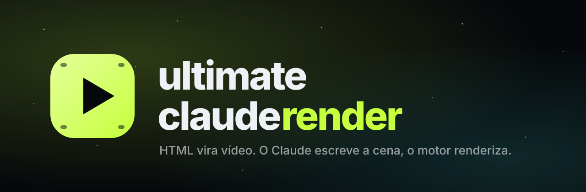
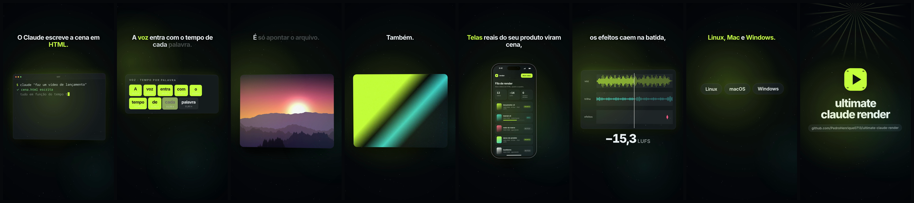
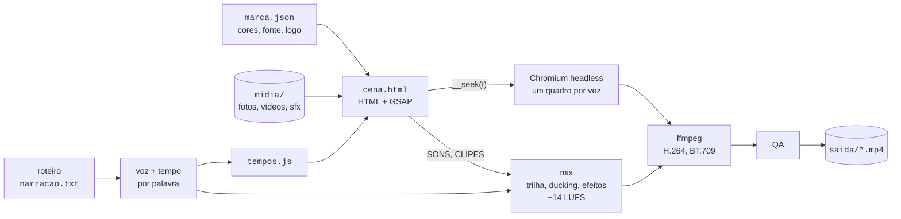

<p align="center">
  
</p>

<p align="center">
  <a href="https://github.com/PedroHenrique0713/ultimate-claude-render/actions/workflows/ci.yml"></a>
  
  
  
  
  
  
</p>

<p align="center"><b>Um vídeo é uma página HTML cujo estado é função do tempo.</b><br>
O Claude escreve a cena. O motor tira cada quadro, a voz entra palavra por palavra, a trilha abaixa sob a fala,<br>
os efeitos caem na batida, o áudio fecha em −14 LUFS e um relatório confere o resultado.</p>

---

## Este vídeo foi feito com ele mesmo

<p align="center">
  <a href="docs/demo.mp4"></a>
</p>

49 segundos, 1080×1920, 30 fps. Roteiro em `exemplos/demo/narracao.txt`, cena em `exemplos/demo/cena.html`, marca em `marcas/exemplo/`. Voz grátis (Edge TTS), trilha sintetizada em numpy, efeitos sintetizados, **nenhuma chave de API**. [Assista ao MP4](docs/demo.mp4).

O que aparece nele é o que o motor faz: terminal que digita, tempo real de cada palavra, legenda que acende no instante da fala, **foto** no meio, **vídeo com o som dele** no meio, tela real de um app em **celular** e em **janela**, mixer com o ducking da própria narração, relatório de QA e troca de paleta ao vivo.

## Como funciona



Tudo que mexe na cena depende só de `t`. Por isso o vídeo é **determinístico**: renderizar de novo dá o mesmo vídeo, dá para refazer só os segundos 30 a 38, e o Claude consegue olhar qualquer instante (`ucr stills`) antes de gastar minutos de render.

## Comece em 5 minutos

Precisa de **Node ≥ 20**, **Python ≥ 3.10** e **ffmpeg** (com libx264).

```bash
git clone https://github.com/PedroHenrique0713/ultimate-claude-render.git && cd ultimate-claude-render
npm install                                  # gsap, three, playwright-core (copia para motor/vendor)
python3 -m pip install -r requirements.txt   # numpy, scipy, pillow, edge-tts
npx playwright-core install chromium         # o navegador do render
node bin/ucr.mjs doctor                      # confere tudo e diz o comando que faltar
```

```bash
node bin/ucr.mjs novo meu-video --marca exemplo   # projeto novo (marca de exemplo)
node bin/ucr.mjs tudo meu-video                   # voz, trilha, efeitos, render e QA
# saida: meu-video/saida/meu-video.mp4
```

Quer o comando `ucr` direto no terminal? `npm link` na pasta do repo. Nos exemplos abaixo, `ucr` = `node bin/ucr.mjs`.

Quer ver o demo inteiro sendo gerado? `ucr tudo exemplos/demo` (≈ 14 min numa máquina de 8 núcleos com vídeo integrado, render em software).

## Com o Claude Code

```bash
ucr instalar-skill          # liga a skill em ~/.claude/skills (atualiza com o git pull)
```

Depois é só pedir:

> Faz um vídeo vertical de 40 segundos do lançamento do meu app. A marca está em `~/marcas/acme/`. Tenho uma foto do produto e uma gravação de tela.

A skill (`skills/ultimate-claude-render/`) leva o Claude pelo caminho certo: **roteiro → quadros de estilo → prévia → render final**, com a marca existente, o QA e as armadilhas já medidas (`references/armadilhas.md`). Outro agente que leia `SKILL.md` (Codex, OpenCode) pode usar o mesmo arquivo.

## Sua marca, em um arquivo

```json
{
  "nome": "Acme",
  "url": "acme.com",
  "logo": "logo.svg",
  "cores": { "fundo": "#0B0D10", "breu": "#14171B", "texto": "#F2F3F5", "destaque": "#FF7A45" },
  "fonte": { "familia": "Inter", "arquivos": { "400": "fonts/Inter-400.woff2", "700": "fonts/Inter-700.woff2" } }
}
```

O resto da paleta (vidro, linhas, auras, texto sobre o destaque) é derivado. Trocar a marca de um vídeo é trocar uma linha do `projeto.json`. Campo a campo: [`references/marca.md`](skills/ultimate-claude-render/references/marca.md).

## O que cabe numa cena

| Quero | Uso |
|---|---|
| Legenda que acende palavra por palavra | `M.legendas(F, { chaves: ['voz'] })` |
| Âncora na fala (não em segundos fixos) | `M.T('sua coleção')` |
| Frase grande em mola | `M.grande('Qualquer vídeo.', { t, fim })` |
| Câmera que nunca para (3D) | `M.camera()` |
| **Foto** no meio | `M.foto(M.cena, 'produto', { de, ate, zoom: [1, 1.12] })` |
| **Vídeo** no meio, com o som | `M.video(M.cena, 'depoimento', { de, ate, som: true })` |
| Tela real no celular ou na janela | `M.celular(...)`, `M.janela(...)` + `ucr filmar` |
| Terminal que digita | `M.terminal(M.cena, { linhas })` |
| Efeito sonoro | `M.som(t, 'impacto')` (10 sintetizados, ou os seus em `midia/sfx/`) |
| Corte na batida da trilha | `M.batida(t)` |
| Contador, gráfico, canvas | `M.ATUALIZAR.push(t => { ... })` |

API completa: [`references/motor-api.md`](skills/ultimate-claude-render/references/motor-api.md). Receitas (horizontal, variantes A/B, troca de paleta): [`references/receitas.md`](skills/ultimate-claude-render/references/receitas.md).

### Foto e vídeo no meio

```bash
cp produto.jpg depoimento.mp4 meu-video/midia/ && ucr midia meu-video
```

```js
M.foto(M.cena,  'produto',     { x: 90, y: 700, w: 900, h: 700, raio: 34, de: 5, ate: 9 });
M.video(M.cena, 'depoimento',  { x: 90, y: 700, w: 900, h: 700, raio: 34, de: 9, ate: 15, som: true });
```

O vídeo vira sequência de JPEG antes do render: o `<video>` do navegador custava 250 a 500 ms por quadro no seek e o Chromium do Playwright nem toca H.264.

## Áudio sem susto

| Parte | Como |
|---|---|
| **Voz** | `edge` (grátis, sem chave), `elevenlabs`, `fal` ou `arquivo` (você gravou; tempos pela Deepgram). O texto da tela é o do seu roteiro. |
| **Respiros** | `"respiros": { "2": 1.2 }`: 1,2 s de silêncio depois da frase 2, para a imagem entrar |
| **Trilha** | sua música (`midia/trilha.mp3`) ou a sintetizada; abaixa sozinha sob a voz |
| **Efeitos** | 10 sintetizados e originais; pastas em `midia/sfx/` têm prioridade |
| **Master** | −14 LUFS e −1,5 dBTP, duas passadas, uma vez só no master |
| **Gasto** | serviço pago passa por um livro com teto em US$ (`"teto_usd"`, padrão 5); estourou, nada é chamado; falhou, é estornado |

Chaves vão em variável de ambiente ou `.env`, nunca no código. Licença: a trilha e os efeitos têm de ter licença comercial se o vídeo for anúncio (os sintetizados têm). O provedor `edge` não libera uso comercial. Detalhes: [`references/audio.md`](skills/ultimate-claude-render/references/audio.md).

## QA que não deixa passar vídeo parado

Todo render termina com um relatório em `saida/<nome> - QA.txt`:

```
QA · ultimate-claude-render-demo.mp4
  ok   1080x1920, 30 fps, 49.06 s, 22.6 Mb/s, 138.5 MB
  ok   cor: yuv420p, faixa limitada, BT.709 marcado
  [!]  7 trecho(s) com a composição parada por 1.5 s ou mais (4% do vídeo): 0.9–2.6 s, 3.4–5.5 s, …
  ok   nenhum trecho preto
  ok   loudness -14.0 LUFS (alvo -14), pico verdadeiro -1.5 dBTP
  ok   todo texto dentro da zona segura
  → 1 ponto(s) para olhar
```

Esse é o relatório real do demo. Na primeira versão ele acusou 38% do vídeo parado e o contador de LUFS entrando na zona da base; a cena foi corrigida até sobrar 4% de trechos calmos (o vídeo aprovado que serviu de referência tinha 5%). Ele mede o que é medível (formato, cor marcada, quadro parado, trecho preto, loudness, pico, texto fora da zona segura da plataforma). **Não é aprovação:** o relatório diz onde olhar e quem aprova é você, vendo o vídeo.

## Linux, macOS e Windows

| | Linux | macOS | Windows |
|---|---|---|---|
| CLI (`ucr`), render, mix, QA | testado | desenhado para rodar | desenhado para rodar |
| Python | `python3` | `python3` | `python` ou `py -3` (o `ucr` acha sozinho) |
| Caminhos, URLs de arquivo | `path` + `pathToFileURL` | idem | idem |
| Chromium | cache do Playwright ou `CHROME_PATH` | idem | idem |
| WebGL (Three.js) | software; `RENDER_GPU=1` usa a placa (Vulkan) | software | software |

Não há script `.sh` no caminho do render: o orquestrador é Node. O fluxo de `.github/workflows/ci.yml` roda `ucr doctor` e um render de fumaça (`exemplos/smoke`, sem voz) nos três sistemas; **ele ainda não rodou**, porque só roda depois do primeiro push. Até lá, só o Linux foi verificado de ponta a ponta (o selo de CI no topo mostra o resultado dos três). A renderização de texto muda um pouco entre sistemas (hinting): o vídeo é o mesmo, o pixel não é.

## Comandos

| Comando | O que faz |
|---|---|
| `ucr doctor` | confere node, ffmpeg, python, Chromium e o motor |
| `ucr novo <pasta> [--marca X --formato vertical\|horizontal\|quadrado]` | cria um projeto |
| `ucr tudo <pasta>` | prep → mídia → voz → tempos → batidas → sons → mix → render → QA |
| `ucr stills <pasta> 2,8.5,15` | PNG de qualquer instante, sem renderizar o vídeo |
| `ucr preview <pasta> [--audio]` | abre a cena no navegador, em tempo real |
| `ucr render <pasta> [--fps --dsf --mb --procs --de --ate --preset --sem-qa]` | só o render (e o QA) |
| `ucr prep\|midia\|voz\|tempos\|batidas\|sons\|mix\|qa <pasta>` | cada etapa sozinha |
| `ucr filmar <plano.json> <saida>` | filma telas reais para usar na cena |
| `ucr instalar-skill` | instala a skill no Claude Code |

## Estrutura

```
ultimate-claude-render/
├── bin/ucr.mjs               CLI
├── motor/                    motor.js, tema.js, motor.css, render.mjs, renderizar.mjs, filmar.mjs
├── gerar/                    voz, tempos, mix, midia, qa, trilha sintética, livro de gasto
├── marcas/                   _modelo/ (copie e edite) e exemplo/
├── exemplos/                 demo/ (este vídeo), smoke/ (teste de CI), modelo-cena.html
├── skills/ultimate-claude-render/   SKILL.md + references/ (API, marca, áudio, receitas, armadilhas)
└── docs/                     banner, demo
```

Cada pessoa mantém os próprios vídeos fora do repo (ou em `projetos/`, ignorado pelo git). O repo é só o motor.

## Limites conhecidos

- **Render é lento por natureza:** o Chromium headless compõe em software. O demo (49 s a 1080×1920, 30 fps, supersampling 1,5, borrão de movimento) levou ≈ 14 min numa máquina de 8 núcleos. A câmera 3D e as auras animadas custam: o mesmo demo levava ≈ 8 min sem elas. Rascunho: `ucr render <pasta> --dsf 1 --mb 1` (bem mais rápido); refazer só um trecho: `--de 26 --ate 34`.
- **A voz grátis (`edge`) usa um endpoint não oficial.** Quando a Microsoft muda algo ele responde 403; `pip install -U edge-tts` costuma resolver. Para trabalho real, use `elevenlabs`, `fal` ou a sua gravação.
- **Cena é código.** O motor entrega as peças, mas o roteiro, o ritmo e o gosto continuam sendo de quem pede e de quem aprova.
- **Sem interface gráfica:** o fluxo é terminal + o Claude (ou outro agente) escrevendo a cena.

## Créditos

[GSAP](https://gsap.com) (timeline), [Three.js](https://threejs.org), [Playwright](https://playwright.dev) (Chromium headless), [ffmpeg](https://ffmpeg.org), [Inter](https://rsms.me/inter/) (OFL), [edge-tts](https://github.com/rany2/edge-tts). O repo não redistribui GSAP nem Three: o `npm install` baixa e copia para `motor/vendor/`.

## Licença

[Apache-2.0](LICENSE). As dependências (GSAP, Three.js, Playwright, ffmpeg, edge-tts) e a fonte Inter (OFL, em `marcas/*/fonts/OFL.txt`) têm licenças próprias.

Projeto independente, sem vínculo com a Anthropic. Claude é marca da Anthropic.
